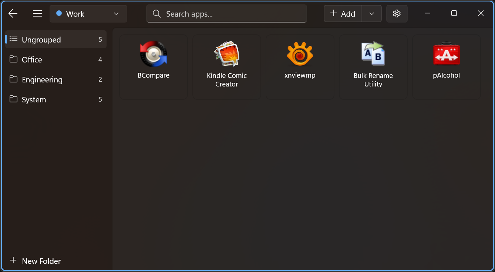

# Ace Run

A lightweight Windows application launcher built with WinUI 3 and C#.

Manage a hierarchical list of `.exe` files and URLs across multiple workspaces and launch them quickly with custom parameters — all from a clean, modern interface.



## Features

- **Quick Launch** — Add executables and launch them with one click
- **URLs & Protocols** — Add web links alongside your apps; custom protocols like `steam://`, `obsidian://` and `ms-settings:` work too
- **Custom Parameters** — Set arguments, working directory, and admin mode per app
- **Drag & Drop** — Drop `.exe`, `.lnk` or `.url` files into the window, or drag a link straight from your browser; silently added with sensible defaults
- **Folder Grouping** — Organize apps into folders with drag-to-reorder; drag tiles onto a sidebar folder to move them there, and go back to the previous folder with `Alt+Left` or the mouse back button
- **Organize** — Right-click a folder in the sidebar to sort it in one pass by name, path, tag, or a custom sort key — or reverse it. The result becomes the new manual order, so drag-to-reorder keeps working afterwards
- **Tags** — Give an app any number of color-coded tags; tag names are searchable, and a folder can be sorted by tag
- **Multiple Workspaces** — Switch between independent app lists, each with its own folders, tags, and accent color; export/import as `.acerun` files
- **Multi-Select** — Select several items and launch, tag, move, delete, or drag them onto a folder in one go
- **Search** — Instantly filter by name, path/URL, launch arguments, or tag name, ranked with recently launched items first; every result shows its folder and can jump to it
- **System Tray** — Minimize to tray, quick-launch recent apps from the context menu
- **Single Instance** — Re-launching brings the existing window to the foreground instead of opening a second copy
- **Icon Extraction** — Automatically displays and caches each app's icon
- **Keyboard Shortcuts** — Drive the whole app from the keyboard; see below
- **Global Shortcut** — Bind a key combination that summons the window from anywhere and puts it away again
- **Settings** — Global shortcut, start with Windows, close-to-tray, hide-after-launch, theme, language, and the automation interface, in their own window
- **MCP Automation** — Let an AI agent read your launcher, and optionally launch and edit through it; off by default, with a read-only setting in between. See below
- **Fluent Design** — Mica backdrop with the workspace color framing the window; light, dark, and high-contrast themes
- **i18n** — English, Traditional Chinese, and Japanese

## Keyboard Shortcuts

| Shortcut | Action |
|---|---|
| `Ctrl+F` / `Ctrl+E` | Focus the search box |
| `Enter` (in search) | Launch the top result |
| `Down` (in search) | Move focus to the results list |
| `Esc` | Clear the search, then close the overlay rail |
| `Ctrl+N` | Add an app |
| `Ctrl+Shift+N` | Add a URL |
| `Ctrl+Alt+N` | New folder |
| `Ctrl+B` | Toggle the sidebar |
| `Alt+Left` / mouse back button | Go back to the previous folder |
| `Ctrl+,` | Open the Manage menu (workspaces / tags / settings) |
| `Ctrl+1`…`Ctrl+9` | Switch to workspace 1–9 |
| `Enter` | Launch the selected item(s) |
| `Alt+Enter` | Edit the selected item |
| `Ctrl+A` (in the item list) | Select every item in the current view |
| `Delete` | Delete the selected items — or the selected folder, in the sidebar |
| `F2` | Rename the selected folder (sidebar) |
| Your global shortcut | Summon the window from any app and land in the search box, ready to type; press again to hide it (off by default — set it in Settings) |

## Requirements

- Windows 10 1809 (build 17763) or later
- .NET 10.0
- Supported platforms: x86, x64, ARM64

## Build

```bash
dotnet build win/ace-run.csproj
```

## Run

```bash
dotnet run --project win/ace-run.csproj
```

## MCP Server

`mcp/AceRun.Mcp` is a [Model Context Protocol](https://modelcontextprotocol.io) server that lets an AI agent work with your launcher: list and search workspaces, folders, items and tags, and — once you switch it on — launch items and edit them.

Queries always work. The server asks the running app for its live state and reads the data files when it cannot, so it answers whether or not Ace Run is running.

Launching and editing go through the running app, because the app owns the live data and rewrites the workspace file on its next save. They are **off by default**: open Settings and set **Automation** to *Read only* or *Launch and edit*. The same card has a **Copy MCP configuration** button that puts a client config with the right path on your clipboard.

```bash
dotnet build mcp/AceRun.Mcp/AceRun.Mcp.csproj
```

Register it with Claude Code:

```bash
claude mcp add ace-run -- "C:\path\to\AceRun.Mcp.exe"
```

Or, in a client that takes a JSON config:

```json
{
  "mcpServers": {
    "ace-run": {
      "command": "C:\\path\\to\\AceRun.Mcp.exe"
    }
  }
}
```

VS Code (Copilot) uses a different shape, in `.vscode/mcp.json` or your user `mcp.json`:

```json
{
  "servers": {
    "ace-run": {
      "type": "stdio",
      "command": "C:\\path\\to\\AceRun.Mcp.exe"
    }
  }
}
```

Queries: `list_workspaces`, `list_folders`, `list_items`, `search_items`, `list_tags`, `get_recent_launches`.

Actions: `launch_item`, `add_item`, `update_item`, `delete_item`, `move_item`, `create_folder`, `rename_folder`, `delete_folder`, `set_item_tags`, `create_tag`, `update_tag`, `delete_tag`, `switch_workspace`, `show_window`, `hide_window`, `clear_recent_launches`.

Workspaces, folders, tags and items are addressed by id or name, and a name that matches more than one thing is an error that lists the candidates rather than a guess. Queries span every workspace with `workspace: "all"` — tags belong to a workspace, so that is how you find which one a tag lives in — and `list_items` filters by `tag` and `folder` and returns a page with the matching total, so ask for the tag you want rather than listing everything.

`add_item` and `update_item` reach every field the app's own edit dialog does except the custom icon, the sort key included — that is the free-form string Organize sorts by. Tags can go on at the same time as an item is added, and a tag can be renamed, recoloured or deleted; deleting one takes it off every item that carried it and leaves the items alone.

The actions address the workspace Ace Run has open, and only that one; `switch_workspace` changes which that is. Items marked to run as administrator are refused unless you also enable **Allow administrator launches**, and `delete_item` / `delete_folder` / `delete_tag` are not confirmed by the app, so your client should ask you first.

A published build puts `AceRun.Mcp.exe` next to `ace-run.exe`, which is how the server starts the app on demand (hidden, in the tray). Set `ACERUN_MCP_NO_AUTOSTART` to stop it doing that.

Design notes and the reasoning behind all of this: [doc/spec/12-mcp-automation.md](doc/spec/12-mcp-automation.md).

## Publish

Self-contained publish (x64). Both the .NET runtime and the Windows App SDK runtime ship inside the output folder (`SelfContained` covers the former, `WindowsAppSDKSelfContained` the latter), so the target machine needs no separate install — at the cost of a ~275 MB folder. `dotnet publish` does not clear the target directory, so empty it first when switching publish settings:

```bash
dotnet publish win/ace-run.csproj -c Release -p:Platform=x64 -r win-x64 -p:PublishProfile=self-contained
```
